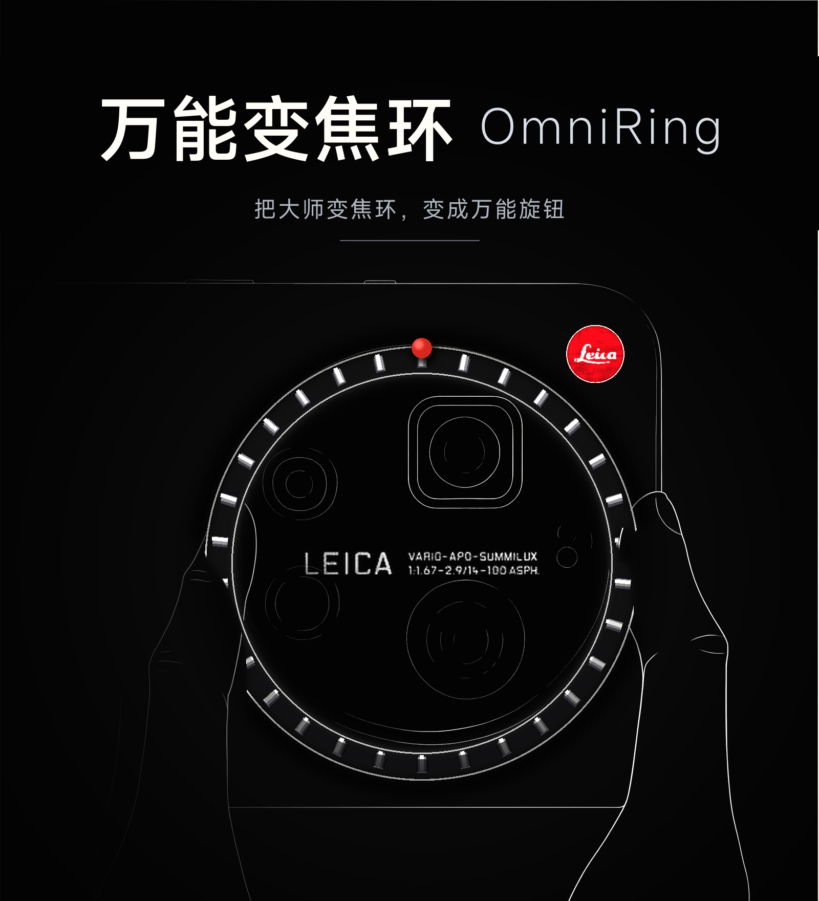

# 万能变焦环 · OmniRing

> 把小米 17 Ultra 徕卡版的**大师变焦环**当成一个通用旋钮用：像 Apple Watch 数码表冠那样
> 1:1 跟手地滚列表，看视频时当进度环快进快退，也可以继续做音量/亮度/启动应用等动作。

> 本仓库 fork 自 [NextAlone/HyperZoomRing](https://github.com/NextAlone/HyperZoomRing)（GPL-3.0）。
> 二改内容、原因与逐文件改动清单见 **[MODIFICATIONS.md](MODIFICATIONS.md)**；上游原文保留在 [README.upstream.md](README.upstream.md)。
> 包名沿用 `xyz.nextalone.hyperzoomring`，这样已装机的设备和 LSPosed 作用域都不用重来。



作者：**TvTjiesen** · 酷安：https://www.coolapk.com/u/22174009 · 仓库：https://github.com/TvTjiesen/OmniRing ·
下载：https://github.com/TvTjiesen/OmniRing/releases/latest

把小米 17 Ultra 徕卡版的物理变焦环当成一个**通用旋钮**用：像 Apple Watch 数码表冠那样
1:1 跟手地滚列表，看视频时当成进度环快进快退，也可以继续用上游的音量/亮度/启动应用等动作。

## 能干什么

| | |
| --- | --- |
| 4 个槽位 × 16 种动作 | 顺时针慢转 / 顺时针快转 / 逆时针慢转 / 逆时针快转各绑一个动作；动作共 16 种：滚动、快进、后退、绝对调进度、上一首/下一首、音量 ±、亮度 ±、手电筒亮度 ±、启动指定应用 |
| 1:1 表冠式滚动 | 环事件是 200ms 一拍到达，本模块把它累加成目标再由帧循环逐帧追平（临界阻尼、不过冲）—— 转快滚快、转慢滚慢，来回转立刻换向 |
| 视频进度环 | 横屏全屏自动把滚动变成调进度；有 MediaSession 走绝对定位，没有就横向拖播放器自己的进度条 |
| 竖屏不抢手 | 竖屏默认不接管进度，避免"我想上下滑，你在快进"（后台放歌时 `isMusicActive` 也为真，就是这里踩出来的） |
| 慢转精细、快转大步 | 同一个环，慢转调音量一格一格，快转直接拉满 |
| 不用猜装没装好 | 首页生效自检分层判定（没进框架 / 待重启 / 开关关 / 环没数据 / 注入全失败）；设置页「本机与适配」卡现读机型、系统版本与适配程度 |
| 不联网 | 清单里没有 `INTERNET` 权限，无广告、无内购、无统计 |
| 四语言 + 主题 | 简中 / 繁中 / English / Русский；跟随系统、浅色、深色、Material You 取色 |

## 为什么需要这个 fork

HyperOS 4 将 `dumpsys input` 的 `InputFilterEnabled` 强制置为 `false`，于是系统不再调用
`InputManagerService.filterInputEvent` —— 那是上游模块唯一的硬件事件入口，**上游 13 个动作
在 HyperOS 4 上全部失效**（写 `settings put global input_filter_enabled 1` 也会被 ROM 忽略）。

本 fork 把触发源换成 `mt350x OPTICALTRACKING` 传感器的数据流，绕开整条输入管线，
并在此之上补齐了滚动与视频进度两件事。

## 新增能力

| 能力 | 说明 |
| --- | --- |
| 表冠式滚动 | 转多少滚多少，方向跟着你转的方向走，来回转立刻换向不抽搐 |
| 视频/音频进度环 | 横屏看片时自动把滚动变成调进度；有 MediaSession 走绝对定位，没有就横向拖播放器自己的进度条（预览由播放器原生显示，暂停也能调） |
| 设置界面 | Miuix 0.9.2 + iOS 液态玻璃：底栏滑块与顶栏都是真玻璃（透镜折射 + 高光），顶栏是三段软窗口叠出的**真渐变模糊**（顶深下浅、有死区渐进出现） |
| 主题与语言 | 跟随系统 / 浅色 / 深色 / Material You 取色（主色、配色规格、调色板风格可调）；**四语**（简中 / 繁中 / English / Русский），界面文案全走资源 |
| 重启作用域 | 右上角液态玻璃悬浮钮（按压/拖拽回弹），有待生效更新时弹红点；iOS 底部动作卡确认 |
| 生效自检 | 首页一张分层判定卡：没进框架 / 待重启 / 总开关关 / 环没数据 / 注入全失败，分别给下一步操作。数据来自模块自己写的心跳（正面证据） |
| 表冠沉浸态 | 点设置页头图，表冠放大居中，**转动物理变焦环直接旋转它**；收不到环事件时降级为手指旋转并说明原因 |
| 设置即时生效 | App 改完设置**不用重启框架**：system_server 读不到 App 的私有 prefs（实测 `exists=false`），所以配置由 App 主动整份推过去（签名级权限挡住伪造），开机时钩子再主动回要一次 |
| 诊断通道 | `Settings.Global hzr_probe` 位图，不用转环即可自测浮窗/会话/注入/配置同步链路 |

## 手感热调（改完约 0.4 秒生效，不用重编译、不用重启）

```bash
adb shell settings put global hzr_scroll_gain 1.20     # 每单位旋转 = 多少像素（想滚更远就加大）
adb shell settings put global hzr_scroll_ease 0.55     # 每帧花掉误差的比例（越小收尾越长）
adb shell settings put global hzr_drag_top 0.30        # 手指落指带上沿
adb shell settings put global hzr_drag_bottom 0.72     # 下沿（某些页面播放器会吃竖向手势，往中间收）
adb shell settings put global hzr_scrub_y 0.45         # 横屏调进度时拖拽的高度
adb shell settings put global hzr_scrub_y_port 0.93    # 竖屏调进度时拖拽的高度
adb shell settings put global hzr_scrub_hold_ms 700    # 停手多久后抬手（决定播放器预览挂多久）
adb shell settings put global hzr_media_seek -1        # -1=听设置里的开关，0=强制关，1=强制开
adb shell settings put global hzr_ring_tau_ms 45         # 应用内表冠：一拍摊到几帧（0=旧的一拍一滚）
adb shell settings put global hzr_ring_px_per_unit 1.2   # 应用内表冠：一个传感器单位 = 多少像素
adb shell settings put global hzr_stage_deg_per_unit 0.06 # 沉浸态表盘：单位→角度（刻度与真实转动同步）
adb shell settings put global hzr_glass_btn_live 1       # 右上角那颗钮是否真采页面内容
adb shell settings put global hzr_debug 1              # 打开后 logcat 有 SMP/SCR/GLASS 逐帧数据
```

## 构建

```bash
# 需要 JDK 21、Android SDK（platform 37 + build-tools 37）
# 交付用 release（R8 + 资源收缩）：46.9MB → 4.67MB，别拿 debug 包当性能基线
./gradlew :app:assembleDebug          # 产物：app/build/outputs/apk/debug/app-debug.apk
./gradlew :app:assembleRelease        # 产物：app/build/outputs/apk/release/app-release.apk（R8）
./gradlew :app:testDebugUnitTest      # 158 个 JVM 单测（真机样本离线回放、生效判定、形变数学、缓动数学、多语对齐）
```

release 的签名配置在没有 `KEYSTORE_FILE` 环境变量时**回落到 `~/.android/debug.keystore`** ——
这是故意的：和 debug 包同一张证书，`install -r` 才能不卸载覆盖，不丢 LSPosed 的模块记录与作用域。
公开发布请给正式 keystore（四个环境变量：`KEYSTORE_FILE/PASSWORD` + `KEY_ALIAS/PASSWORD`），
注意换签名那一次必须卸载重装。

本机到 `dl.google.com` 是超时（Gradle 遇到连接失败不会顺延到 Maven Central），
而 `assembleRelease` 需要 `org.jetbrains.kotlin:compose-group-mapping`，
所以仓库根放了个 `localmaven/` 本地镜像（不进版本库）。CI 上网络正常，不需要它。

## 安装

1. 安装 APK；
2. 在 LSPosed 中启用本模块，作用域勾选 **System Framework（system）**；
3. 打开一次 **LSPosed 管理器**（实测：光 `adb install -r` 不会让模块库里的 `apk_path` 追上，
   连装四次都不追；开一次管理器才触发重扫，路径不一致时下一步会白做）；
4. 软重启框架生效：`adb shell su -c "kill -9 $(pidof system_server)"`（约 25 秒）；
5. 打开模块，确认「启用变焦环」为开，作用域勾 **System Framework（system）**。

## 性能与体积（release 包，Xiaomi 17 Ultra 徕卡版真机量的）

| 指标 | debug 包 | release（R8） |
| --- | --- | --- |
| APK 体积 | 46,979,097 B | **4,674,208 B（-89.9%）** |
| 前台静置 CPU | 251 jiffies/20s | **113 jiffies/20s** |
| 滑动 jank | 0.17%，p50 7ms / p90 9ms / p99 17ms | **0.06%，p50 5ms / p90 6ms / p99 10ms** |
| 设置项读取 | 轮询 ≈525 次 binder/分 | **事件驱动 ≈28 次/分** |

应用内表冠的"顿挫"是另一回事：环事件 200ms 一拍，一拍就 `scrollBy` 一次 = 一秒 5 个台阶。
现在每拍只往目标累加像素、由帧循环逐帧追平（临界阻尼、不过冲），
同一拍 30px 从"1 帧吃完"变成摊到 11 帧、单帧最大 9.1px，位移不吞。

本应用**没有 INTERNET 权限**（清单里只有 `QUERY_ALL_PACKAGES` 与自己那条签名级权限），
不联网、不采集，全部逻辑在设备内完成。

## 代码来源与占比

`tools/code_share.py` 统计（57 个 .kt / 6534 行）：

| 来源 | 文件 | 行 | 占比 |
| --- | --- | --- | --- |
| 本 fork 新增 | 19 | 3059 | 32% |
| 移植自 Miuix 示例的液态玻璃（Apache-2.0） | 10 | 1438 | 15% |
| 本 fork 重写的上游文件 | 7 | 1313 | 13% |
| 上游原样保留 | 40 | 3683 | 38% |

上游原样保留的部分主要是音量/亮度/手电筒这类动作实现和几个小枚举；传感器链路、表冠模型、
滚动与进度注入、整套界面都是本 fork 写的。GPL-3.0 要求的声明保留在 `LICENSE`、
本文件与 `MODIFICATIONS.md`。

## 致谢

- [Miuix](https://github.com/compose-miuix-ui/miuix) · Apache-2.0 —— 界面组件与主题
- [Kyant0/AndroidLiquidGlass](https://github.com/Kyant0/AndroidLiquidGlass) · Apache-2.0 —— 液态玻璃的透镜/内阴影/阻尼拖拽
- [HighCapable/YukiHookAPI](https://github.com/HighCapable/YukiHookAPI) · Apache-2.0 —— Xposed 钩子框架
- [HighCapable/KavaRef](https://github.com/HighCapable/KavaRef) · Apache-2.0 —— 反射工具库
- [Jetpack Compose](https://developer.android.com/jetpack/compose) · Apache-2.0
- [LSPosed](https://github.com/LSPosed/LSPosed) · GPL-3.0 —— 承载本模块
- [NextAlone/HyperZoomRing](https://github.com/NextAlone/HyperZoomRing) · GPL-3.0 —— 本仓库的上游

App 内「设置 → 致谢」同样列出这些项目并可直达仓库。

## 已知限制

- 环只有旋转、没有按压，所以"半按对焦全按快门"这类做不到。
- HyperOS 4 的列表不响应 `AXIS_SCROLL`/`AXIS_VSCROLL`（实测各注入 12 次截图零变化），
  因此滚动是**合成真实触摸拖拽**实现的。
- 小米自带播放器与 B站 竖屏详情页**不发布 MediaSession**，这类应用的进度只能靠横向拖拽；
  B站 竖屏详情页整页被应用自己的"竖屏连播"接管，那里环管不了进度（横屏全屏正常）。
- 只在 Xiaomi 17 Ultra（`nezha`）+ HyperOS 4 / Android 17 上实测过。

- **更新 APK 后要在 LSPosed 里确认模块还加载着**：`adb install -r` 会换 `codePath`，
  LSPosed 的 db 要一会儿才跟上；装完立刻重启框架，开机时它会报
  `Failed to open APK '<旧路径>'` 并**静默不加载模块**。等 ~30 秒再重启，或在 LSPosed
  里把模块关开一次。

## 许可

GPL-3.0，与上游一致。必须保留 `LICENSE` 与本文件、`MODIFICATIONS.md` 的署名与改动声明，
并以同样的 GPL-3.0 公开任何再分发版本。依赖的 YukiHookAPI / KavaRef / Miuix 为 Apache-2.0，
与 GPL-3.0 兼容。
